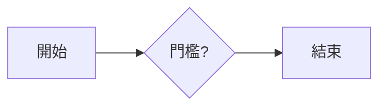

# 測試指南

這份文件有 **門檻** 這個詞，後面還會出現門檻。

## 程式碼

```csharp
public sealed class Gate { public int Count = 42; }
```

## 流程圖



## 公式

行內公式 $E = mc^2$ 和區塊公式：

$$
\int_0^1 x^2 \, dx = \frac{1}{3}
$$

## 圖片與連結


看 [另一份的第二節](other.md#第二節)。

最後一個門檻。
